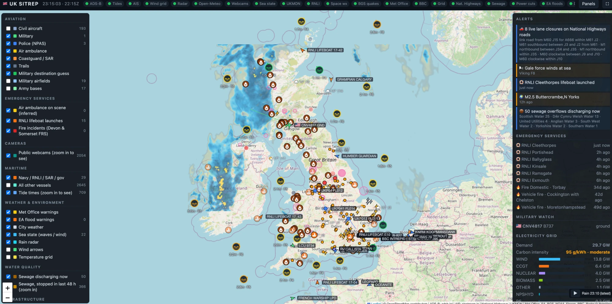
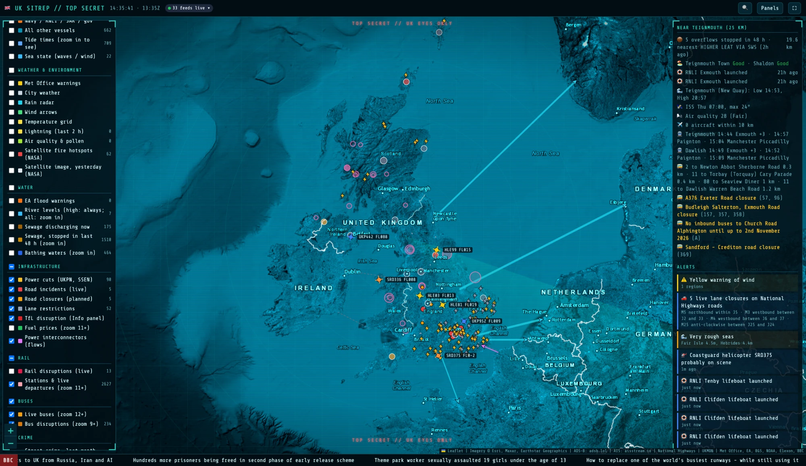
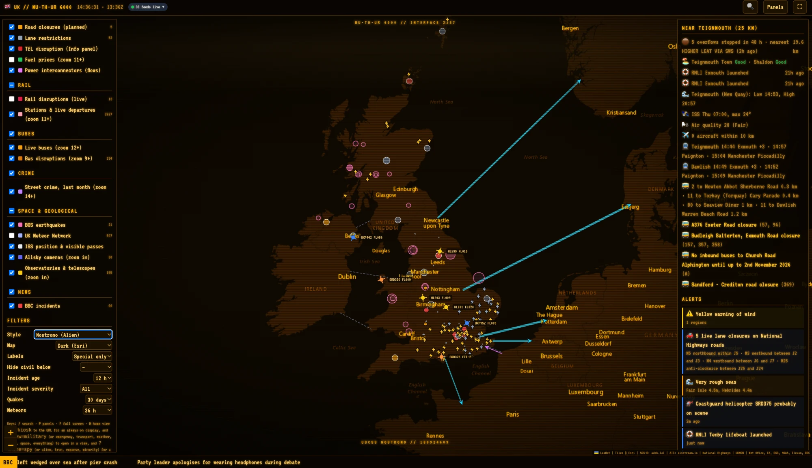
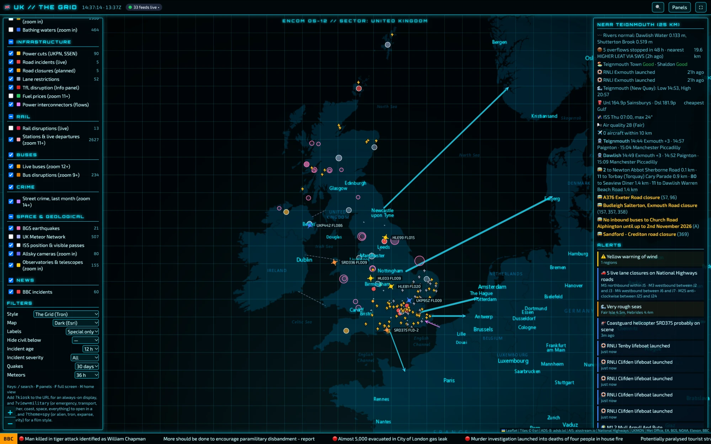
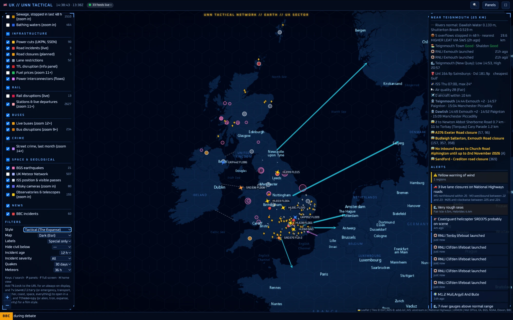
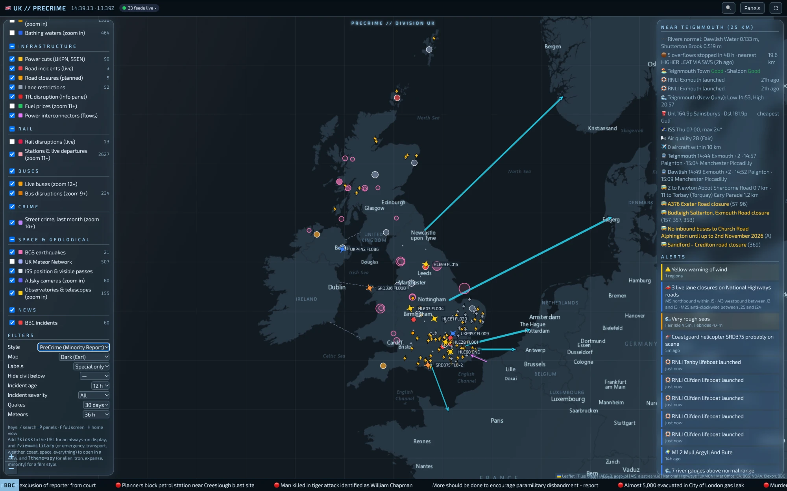
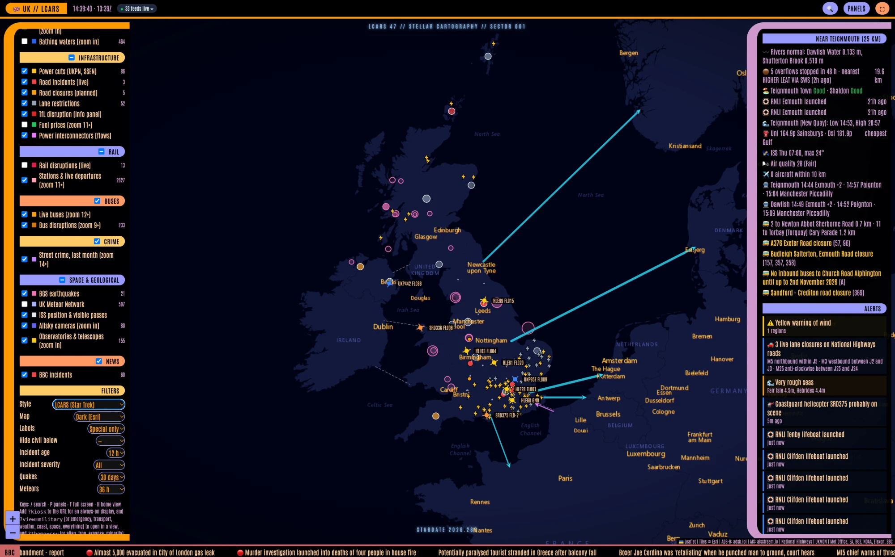
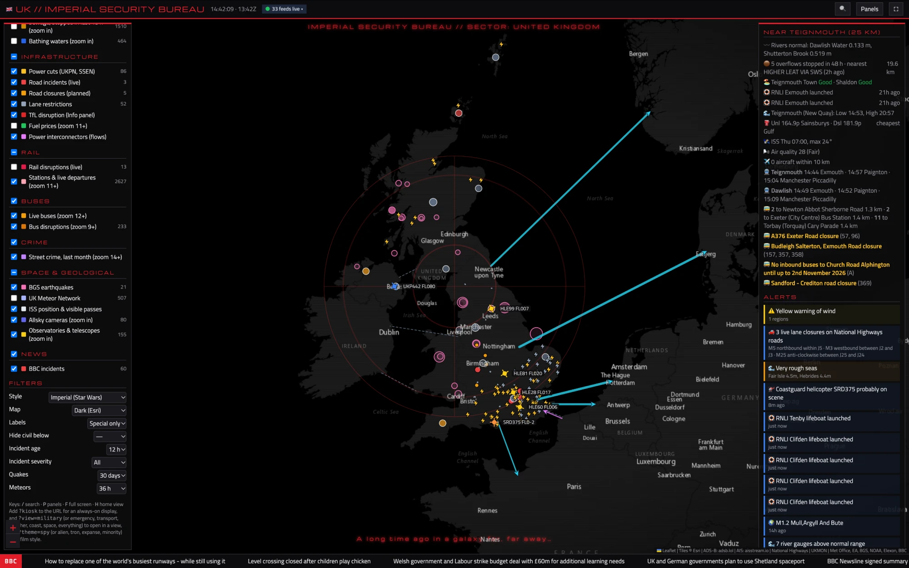

# UK SitRep

A live, full-screen UK situational-awareness map that brings aviation, maritime,
weather, infrastructure, emergency-service and news feeds together on one display.
It's built for an always-on screen, and the layout also works on a phone.

One small Python (aiohttp) service serves the map and a set of cached JSON feeds.
It runs as a ~70 MB distroless container with no shell, as a non-root user.



## Layers

| Group | What's shown |
|---|---|
| Aviation | Live ADS-B aircraft with trails, labels, full type names, a photo and the scheduled route in the popup. Military aircraft get country flags, and police (NPAS), air ambulance and coastguard aircraft are picked out. Emergency squawks (7500/7600/7700) are flagged. Also: military airfields and army bases, and a guess at where military aircraft are heading |
| Emergency & safety | Air ambulance / coastguard helicopter "on scene" (inferred from landings away from bases and hospitals), RNLI lifeboat launches, and fire & rescue incidents from Avon, Buckinghamshire, Cheshire, Cleveland, Hampshire & IoW, Royal Berkshire and Shropshire, plus Devon & Somerset (optional), each with its own toggle. Hospitals (zoom 9+, red for those with an emergency department) with phone and website where mapped. Defibrillators (zoom 14+) with location, access and availability, and life rings and lifeguard posts (zoom 13+), from OpenStreetMap: volunteer-mapped, so treat them as a guide and call 999 in an emergency |
| Maritime | Live AIS ships (Royal Navy, RNLI, coastguard, police and government vessels and distress beacons highlighted; a ship's popup shows its size, IMO number and a photo from Wikimedia Commons where one exists), tide times, and sea state for the Shipping Forecast areas |
| Weather | Met Office warnings, rain radar (animated), wind arrows, temperature grid, city weather, lightning |
| Energy | Power cuts (UKPN, SSEN), electricity grid mix and demand, interconnector flows to and from Europe and Ireland. The 14 grid regions shaded by carbon intensity, solar output or Octopus Agile price (tap one for its mix, solar and the next day's prices). Every wind farm and power station with its live output (wind turbines spin faster the harder they're working). Near home shows the Agile price now, the cheapest and cleanest 3 hours ahead, and any negative prices |
| Space & geology | BGS earthquakes, UK Meteor Network meteor tracks, NOAA Kp index, AuroraWatch UK, ISS position, ground track and visible passes from the map centre; when zoomed in, public allsky cameras (Allsky and indi-allsky) with their latest image, and observatories, radio telescopes and planetaria with links to their sites |
| Water | Environment Agency flood warnings; river gauges for England (EA) and Scotland (SEPA) (against their normal range, with rising/falling trend); live sewage storm overflow status from all 11 water companies (discharging now, and stopped within the last 48 hours) |
| Air & fire | Air quality and pollen (CAMS via Open-Meteo); NASA FIRMS satellite fire hotspots (optional key); NASA GIBS satellite image overlay |
| Beaches | Bathing water classifications and daily pollution-risk forecasts, cross-referenced with nearby sewage. Sea glass hunting (optional, `ENABLE_SEAGLASS`): this week's Top 25 UK beaches with the seaglasshunting.com ShoreSense score, best window and sea state, shown as numbered markers from zoom 7, with every other beach the site maps as a small grey dot from zoom 9, and the top 5 in the Info panel |
| Local services | Live forecourt fuel prices with brand logos (GOV.UK Fuel Finder, optional credentials) from zoom 11; EV chargers from zoom 13 (Open Charge Map, optional key); public toilets (OpenStreetMap) from zoom 14, with fee, hours and wheelchair access where mapped; cash machines (OpenStreetMap, no key) from zoom 15, coloured by whether a fee is recorded (grey = not recorded, not free); post boxes (OpenStreetMap, no key) from zoom 16, with reference, cypher and collection times where mapped |
| Travel & transport | National Highways closures, lane restrictions and live incidents; TfL line disruption in the Info panel; plus rail and buses below |
| Crime | police.uk street crime around the map centre (zoom 14+), falling back to the latest month a force has published |
| Rail | Live disruptions pinned to the stations affected (National Rail, optional key), and from zoom 11 every station with its live departure board: times, platforms, delays, cancellations and reasons (Darwin, optional key). Near home shows your stations' next trains |
| Buses | From zoom 12, every bus in England moving live with its route number and direction; tap for destination, operator and vehicle. From zoom 9, operators' disruption notices (diversions, closed roads and stops) pinned to the stops affected. From zoom 15, bus stops: tap one for its next departures, with 🛰 and the distance when a tracked bus is running that journey. Near home shows your nearest stop's next buses, the buses passing nearby and local disruptions (Bus Open Data Service: live buses need a key; timetables need `BUS_TIMETABLE_REGIONS`) |
| Tides | High and low water times, heights and a 30-hour curve for about 700 UK and Irish ports (Admiralty EasyTide), shown when zoomed in |
| Cameras | TfL JamCams, OpenStreetMap-tagged webcams, your own curated list, and the WorldCam directory (optional) |
| News | BBC UK, nations and local feeds, pinned to the places they mention, filtered by severity and age, plus a scrolling ticker |

## Opening position

The map opens zoomed in on your home (the `HOME_*` for the link you use, or the home picked
in Near home); zoom out as usual. The **⌂** and **UK** buttons under the zoom buttons (keys `H`
and `U`) jump back to the home or out to the whole country. Add `?uk` to the URL to open on the
whole country instead, e.g. for a wall display.

**◎** between ⌂ and UK at bottom left (key `L`) zooms to where this device is, with a blue dot and
its accuracy circle. With no home set (`HOME_LAT`/`HOME_LON` unset) the map opens there too, and
⌂ goes there. Browsers only share location with https pages, and the page counts as http if the
Home Assistant app is on its internal `http://` address (as it usually is on home Wi-Fi). In that
case, inside the Home Assistant panel, the map uses your own `person` entity's location (the
companion app's GPS fix) instead. On a plain `http://192.168…` link outside Home Assistant there
is no location. On https the browser (or app) asks permission the first time.

## Navigation and dropped pins

Popups for places (stations, bus stops, chargers, cash machines, post boxes, fuel, favourites and so on) end with a
**🧭 Navigate** button that opens turn-by-turn directions in Apple Maps, Google Maps or Waze. It uses plain links, so
no keys are needed and the routing is done by the maps app on your device (on a phone, the same app CarPlay uses).
The first time it picks Apple Maps on iPhone and iPad and Google Maps elsewhere; change it with the drop-down next
to the button and your choice is remembered on that device until you change it again. Moving things (aircraft,
ships, live buses) don't get the button.

**Long-press** (touch) or **right-click** (mouse) anywhere on the map to drop a pin. Its popup shows the coordinates
and the nearest postcode (postcodes.io, Great Britain), the Navigate button, **☆** to save it as a favourite and
**Remove pin**.

**🆘 Where am I?** (button under ⌂ ◎ UK, and a link in a dropped pin's popup) opens a panel with a sentence to read out to the
emergency services: nearest postcode and area, OS grid reference, latitude/longitude, Plus Code and GPS accuracy, with Call 999,
Copy and Share buttons. The grid reference and Plus Code are worked out in the page; only the postcode lookup needs the server.

## Favourites

Open a station, bus stop, webcam, allsky camera, observatory, tide station, river gauge,
bathing water or fuel station and tap **☆** at the top of its popup. Favourites get a gold pin
on the map and a list in the Info panel (tap one to fly there and open it), and the
*Favourites* view shows just them. The list is kept on the server, one per home, so the Home
Assistant panel, your phone and a wall display opened with the same link all share it
(`favourites.json` in `DATA_DIR`).

## Views

The layer panel has a **View** menu that switches many layers at once: *Everything*,
*Favourites*, *Energy*, *Military*, *Emergency*, *Travel & transport*, *Local services*, *Weather & water*, *Coast & sea* and
*Space*. *My layers* puts back the set you had before picking a view. Each group heading has
its own checkbox, and *All on* / *All off* sit at the top.

Add `?view=<name>` to the URL to open in a view (`favourites`, `energy`, `military`, `emergency`, `transport`, `services`,
`weather`, `coast`, `space`, `everything`), e.g. for a wall display:
`https://<host>/k/<ACCESS_TOKEN>/?kiosk&view=military`.

## Styles

For fun, **Layers → Filters → Style** restyles the whole screen without changing any data. The styles are original
homages to familiar screen-sci-fi and fantasy looks; they use generic names, original wording and open-licensed
fonts only, and are not affiliated with or endorsed by any film, show or game (see `NOTICE.md`).

| Style | Look |
|---|---|
| **Spy HQ** | Satellite map in cold teal, grid, range rings and a radar sweep, typewriter font, "TOP SECRET // UK EYES ONLY" banners, target brackets on emergency squawks |
| **Retro Terminal (Amber CRT)** | Amber CRT: scanlines, a rolling refresh bar, VT323 terminal font, ship-computer boot-up |
| **Neon Grid (Cyber)** | Black and neon cyan, glowing panels and grid |
| **Fleet Tactical (Hard Sci-fi)** | Navy and blue with amber highlights, cut-corner panels, hex grid |
| **Glass Foresight (Future UI)** | Frosted-glass panels in white and pale blue |
| **Starship Console (Sci-fi Bridge)** | Black with orange, lilac and blue pill buttons, elbow-framed panels, ship-date banner |
| **Space Opera (Crawl)** | Steel grey and red, a targeting reticle, and a receding-text crawl as the boot sequence |

<table>
<tr><td align="center" width="50%"><br>Spy HQ</td><td align="center" width="50%"><br>Retro Terminal (Amber CRT)</td></tr>
<tr><td align="center" width="50%"><br>Neon Grid (Cyber)</td><td align="center" width="50%"><br>Fleet Tactical (Hard Sci-fi)</td></tr>
<tr><td align="center" width="50%"><br>Glass Foresight (Future UI)</td><td align="center" width="50%"><br>Starship Console (Sci-fi Bridge)</td></tr>
<tr><td align="center" width="50%"><br>Space Opera (Crawl)</td></tr>
</table>

The later styles are Cyberpunk Noir (rain and neon), Desert Planet, Sky Lanes (flying-car lanes), Art Deco (1920s silent-film look),
Red Eye (a glowing red computer eye), Digital Rain (falling code, drawn on a canvas that pauses in a hidden tab), Radar Ops
(green phosphor tactical ops room: range rings, bearing ticks, radar sweep, aircraft and ship blips, and a status line with a Zulu
date-time group, grid reference and warning condition; plus a red night version), Glass Lab, **Epic Fantasy / Wayfarer's Map** (parchment,
a slow compass rose and drifting embers), **Luminous Forest** (night-jungle glow with drifting light seeds), **Steampunk**
(copper, riveted frames, turning gears and rising steam) and **Bedtime Meadow** (a gentle twilight for children: soft indigo,
pastel accents, round corners, a rainbow, stars and fireflies).
**Inspired by** (a plain-text credit, no affiliation implied): Retro Terminal, 1970s-80s sci-fi horror ship computers; Neon Grid, early-80s
computer-world sci-fi; Fleet Tactical, near-future space-opera naval displays; Glass Foresight, gesture-interface future-crime thrillers;
Starship Console, the touch-panel bridge of a classic TV starship; Space Opera, the receding-text opening crawl of 1970s space fantasy;
Cyberpunk Noir, rainy neon future-noir cinema; Desert Planet, sweeping desert-world epics; Sky Lanes, flying-car future cities;
Art Deco, 1920s silent-film cities; Red Eye, the calm rogue-AI of 1960s space cinema; Digital Rain, the falling green code of late-90s hacker films;
Glass Lab, minimalist AI-lab thrillers; Epic Fantasy, quest-map high fantasy; Luminous Forest, glowing alien-moon jungles;
Steampunk and Bedtime Meadow are genres and need no credit.

Each plays a short boot sequence (click to skip). Marker colours keep their meaning in every
style, and radar and satellite imagery keep their real colours. Add `?theme=spy` (or `alien`,
`tron`, `expanse`, `minority`, `lcars`, `imperial`, `bladerunner`, `dune`, `fifth`, `metropolis`, `odyssey`, `matrix`, `overwatch`, `overwatch_night`, `machina`, `wayfarer`, `luminous`, `steam`, `meadow`) to the URL for a wall display. The keys are the original short names and are kept so existing links keep working. Fonts load from Google Fonts.

## Finding a place

Press **🔍** (or `/`) and type a town, village, postcode (`TQ14 8AA`), part of one (`GL20 5`),
postcode district (`GL20`), coordinates (`51.5, -0.12`), or an area: a county, unitary
authority, district, English region, nation or national park (`Gloucestershire`, `Forest of Dean`,
`South West`, `Dartmoor`). Suggestions appear as you type; Enter or a click flies the map there.
A place gets a pin; an area is outlined and fills the screen. Or pick an area from the drop-down
under the box: nations and regions first, then each region's counties with their districts
indented. ✕ removes the pin or outline. Place names come from postcodes.io (OS Open Names, Great
Britain); areas cover the whole UK. Other keys: `P` panels, `F` full screen, `H` home, `U` whole UK.

## Version

The version runs next to the title in the top bar (desktop) and at the bottom of the Layers panel.
The server checks GitHub every six hours: when a newer version is out it turns amber with ⬆ and
says "Pull and redeploy" (on a phone it only appears then). After a redeploy, a page that was
already open says "reload the page". `/healthz` also reports the version.

## Quick start

```bash
cp .env.example .env        # add keys / ACCESS_TOKEN
docker compose up -d        # then open http://<host>:8080/?token=<ACCESS_TOKEN>
```

Or build it yourself: `docker build -t uksitrep .`

**Portainer:** create a stack from this repository (or paste `docker-compose.yml` into the web
editor) and add the settings under *Environment variables*. The compose file's `environment:`
block passes them into the container. Set `HOST_PORT` to publish on a port other than 8080.
Check `http://<host>:<port>/healthz`: its `features` list shows which settings reached the container.

Without Docker (Python 3.11+): `pip install -r requirements.txt && DATA_DIR=./data python -m uksitrep`

## Configuration (environment variables)

| Variable | Default | Purpose |
|---|---|---|
| `ACCESS_TOKEN` | *(none — open)* | Require the token on every request: `/?token=…`, `/k/<token>/` (path form, for apps that drop query strings, e.g. the HA iOS app), or `Authorization: Bearer …` |
| `AISSTREAM_API_KEY` | — | Live ships ([aisstream.io](https://aisstream.io), free). Connects only while someone is viewing |
| `NATIONAL_HIGHWAYS_KEY`, `NATIONAL_HIGHWAYS_KEY_SECONDARY` | — | Road closures and incidents ([developer portal](https://developer.data.nationalhighways.co.uk)) |
| `BBC_LOCAL_REGIONS` | — | Extra BBC England local feeds, e.g. `gloucestershire,devon` |
| `ENABLE_BACKGROUND_ADSB` | `true` | Poll ADS-B continuously so on-scene detection works with no viewer |
| `FIRMS_MAP_KEY` | *(none)* | NASA FIRMS key for satellite fire hotspots ([free](https://firms.modaps.eosdis.nasa.gov/api/map_key/)) |
| `FUEL_FINDER_CLIENT_ID`, `FUEL_FINDER_CLIENT_SECRET` | *(none)* | GOV.UK Fuel Finder API credentials for live forecourt prices ([register](https://www.developer.fuel-finder.service.gov.uk/access-latest-fuelprices)) |
| `RAIL_LDB_KEY` | *(none)* | Live departure boards: consumer key of the free **Live Departure Board** product on the [Rail Data Marketplace](https://raildata.org.uk) (Specification tab) |
| `RAIL_DISRUPTIONS_KEY` | *(none)* | Live rail disruptions: consumer key of the **National Rail Disruptions** product on the Rail Data Marketplace |
| `OCM_API_KEY` | *(none)* | EV chargers: a free API key from [Open Charge Map](https://openchargemap.org/site/develop/api) (My Profile → My Apps) |
| `OPEN_METEO_DAILY_CALLS` | `4000` | Most Open-Meteo calls (weather, wind grid, sea state, air quality) your server may make per day. The free tier allows 10,000 and counts every location as a call; past this budget the feeds keep showing their last data until midnight UTC |
| `BODS_API_KEY` | *(none)* | Live buses and bus disruptions (England): API key from a free data-consumer account on the [Bus Open Data Service](https://data.bus-data.dft.gov.uk/account/signup/) |
| `BUS_TIMETABLE_REGIONS` | *(none)* | Bus stops and timetabled departures for these Bus Open Data Service regions, e.g. `south_west` (also `north_east`, `north_west`, `yorkshire`, `east_midlands`, `west_midlands`, `east_anglia`, `south_east`, `london`). No key. Choose any number, comma-separated (`south_west,london`); unset loads no bus stops. Each is a ~250 MB weekly download, indexed in the background to ~40 MB, so disk, bandwidth and indexing time scale with the number of regions; the first start takes a couple of minutes per region. Adding a region downloads it on the next start; removing one stops it being used (its folder in `DATA_DIR/bustimes/` can then be deleted) |
| `RAIL_STATIONS` | the 2 nearest home | Your stations' 3-letter codes for the Near home panel and notifications, e.g. `TGM,NTA` |
| `HOME_LAT`, `HOME_LON`, `HOME_NAME`, `HOME_RADIUS_KM` | *(none)*, `Home`, `25` | Your home area: shows a "Near home" panel (rivers, floods, sewage, beaches, fire, roads, power cuts, lifeboats, lightning, tide, cheapest fuel, ISS, air quality) and a radius ring |
| `HA_WEBHOOK_URL` | *(none)* | Post new nearby events to a Home Assistant webhook (needs the home area), e.g. `http://<ha-ip>:8123/api/webhook/<id>` |
| `HOME2_NAME`, `HOME2_LAT`, `HOME2_LON`, `HOME2_RADIUS_KM`, `HOME2_TOKEN`, `HOME2_WEBHOOK_URL`, `HOME2_RAIL_STATIONS`, `HOME2_NOTIFY` | *(none)* | A second home (and `HOME3_*` … `HOME9_*`). Each home has its own Near home panel, stations and notifications. `HOMEn_TOKEN` is an extra access token (needs `ACCESS_TOKEN` set) that opens the map on that home, so each household can have its own link; anyone can switch homes from the Near home title. `?home=<name>` also picks one |
| `NOTIFY` | all | Which events to send: `warning,flood,river,sewage,fire,road,power,rnli,aircraft,hems,lightning,iss,rail,bus,agile` (`agile`: once a day when your region's Octopus Agile price is going negative; `rail`: cancellations and delays of 15 min+ at your stations, and disruptions nearby; `bus`: unplanned bus disruptions nearby) |
| `ENABLE_LIGHTNING` | `false` | Live lightning from Blitzortung.org. Off by default: Blitzortung data is for its registered station owners and private, non-commercial use, and it asks that apps take the data from their own server rather than theirs. Switch it on only if that applies to you |
| `ENABLE_SEAGLASS` | `false` | Sea glass hunting forecast: this week's Top 25 UK beaches (the ShoreSense score) from [seaglasshunting.com](https://seaglasshunting.com), shown on the map from zoom 7 and as a top 5 in the Info panel. There is no API, so this reads their leaderboard page every 3 hours and their map page weekly. Off by default; check their terms before enabling |
| `ENABLE_WORLDCAM` | `false` | Import the worldcam.eu directory (scraped; weekly refresh) |
| `FIRE_SERVICES` | all seven | Fire & rescue services read from their public feeds: `avon,bucks,cheshire,cleveland,hants,rbfrs,shropshire`. Remove any you don't want |
| `ENABLE_DSFRS` | `false` | Also show Devon & Somerset FRS incidents. These are read from their incidents web page, so this is off by default |
| `DSFRS_STATION_IDS` | the 10 Teignbridge + Torbay stations | Only used with `ENABLE_DSFRS`: which stations' incidents to fetch (DSFRS station filter ids, comma-separated) |
| `DSFRS_AREAS` | `Teignbridge,Torbay` | Only used with `ENABLE_DSFRS`: keep incidents in these districts (drops calls where those crews helped elsewhere) |
| `CAMERAS_FILE` | bundled `config/cameras.json` | Your curated webcams |
| `PORT`, `DATA_DIR`, `LOG_LEVEL` | `8080`, `/data`, `INFO` | |

## Home Assistant notifications

Set `HOME_LAT`/`HOME_LON` and `HA_WEBHOOK_URL`, then add an automation with a webhook trigger:

```yaml
automation:
  - alias: UK SitRep - nearby event notifications
    mode: queued
    trigger:
      - platform: webhook
        webhook_id: uksitrep-<random>      # the end of HA_WEBHOOK_URL
        allowed_methods: [POST]
        local_only: true
    action:
      - service: notify.mobile_app_<your_phone>
        data:
          title: "{{ trigger.json.title }}"
          message: "{{ trigger.json.message }}"
```

The service checks every 5 minutes and sends each thing once: a given sewage overflow, river
gauge, fire incident, road closure or power cut is not sent again for 7 days, however often it
stops and restarts, unless it gets worse (a flood alert becoming a warning, a river going from
high to record). Lightning is once a day. It remembers what it sent in `/data/notified.json`; on
first start it records what's already happening instead of sending it.

With several homes, each posts to its own `HOMEn_WEBHOOK_URL` (it can be a different Home Assistant),
and the payload's `home` field says which home it's about.

## Embedding in Home Assistant

Add a dashboard in panel view containing a Webpage (iframe) card:

```yaml
type: iframe
url: https://<host>/k/<ACCESS_TOKEN>/
```

Add `?kiosk` to the URL (e.g. `https://<host>/k/<ACCESS_TOKEN>/?kiosk`) to hide the layer panel on a wall display.

An iframe only works where the browser can reach the map. To use it away from home as well,
let Home Assistant proxy it: install the [Ingress](https://github.com/lovelylain/hass_ingress)
integration (HACS) and add a sidebar panel. HA's login then protects it and nothing new is exposed:

```yaml
ingress:
  uk_sitrep:
    title: UK SitRep
    icon: mdi:radar
    ui_mode: toolbar
    url: !secret uk_sitrep_url    # http://<host>:8080/k/<ACCESS_TOKEN or HOMEn_TOKEN>/
```

The Home Assistant must be able to reach the container's address itself (same network, or a VPN between sites).

## Security notes

* The feeds are fixed, allow-listed sources, so the service can't be used as an open proxy.
* Set `ACCESS_TOKEN` if the service is reachable from outside your network: anyone viewing it uses your AIS key.
* API keys only ever come from environment variables. Never commit `.env`.

## Building one for another country

See [CLAUDE.md](CLAUDE.md): it covers how the project is put together, which constants and
feeds are UK-specific, global feeds you can keep, and how to find and add local ones. It's written
so Claude Code can follow it too.

## Data sources and licences

See [NOTICE.md](NOTICE.md). Most sources are open data (OGL, CC-BY, ODbL). Some are
read from public web pages and are **off by default**; check their terms before enabling them.
